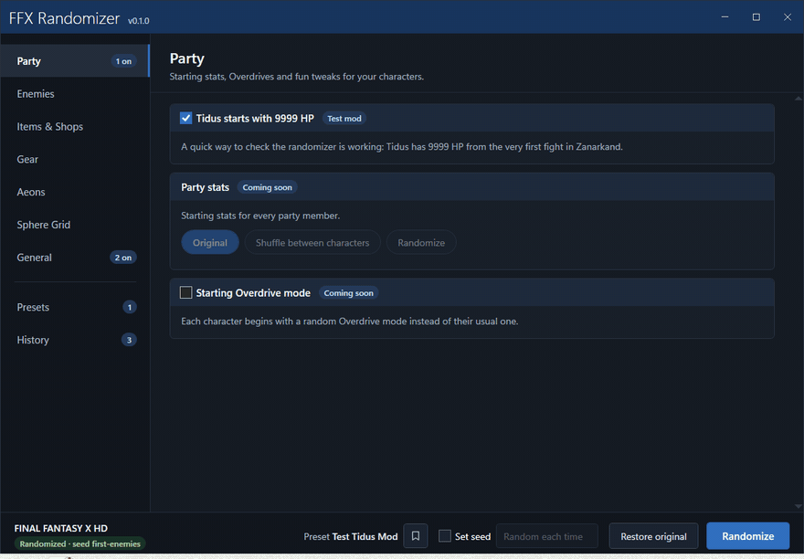
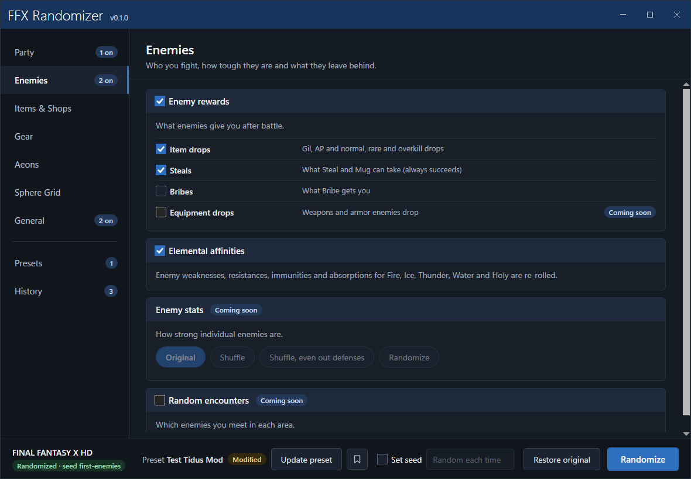
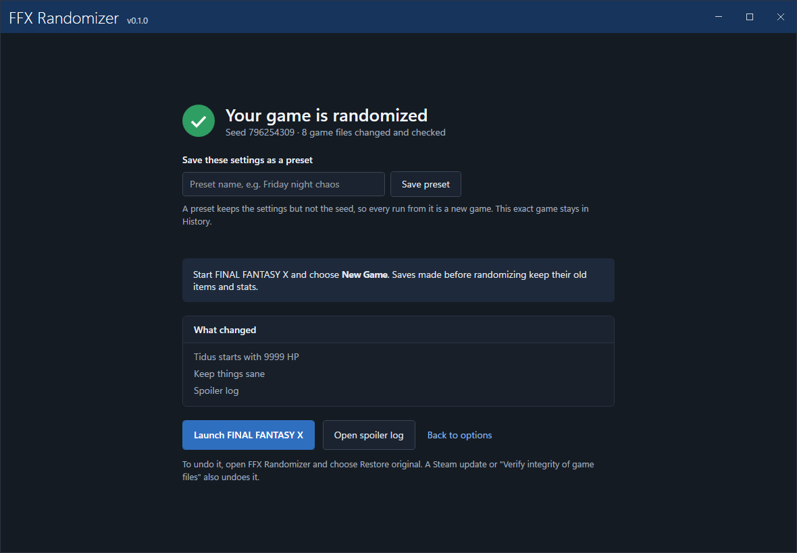
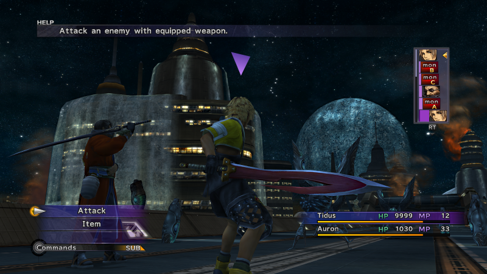
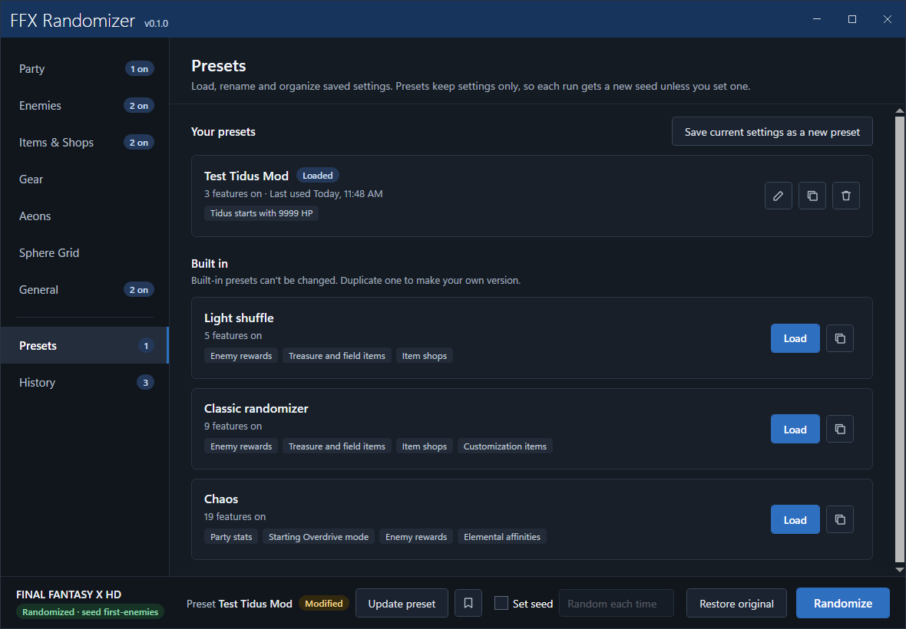
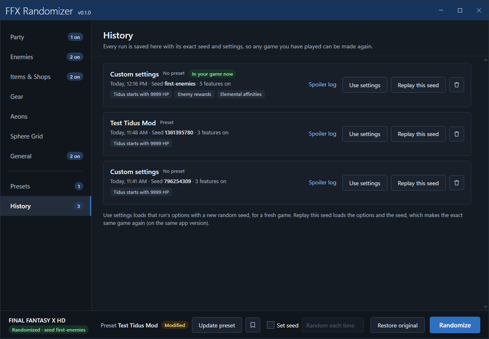
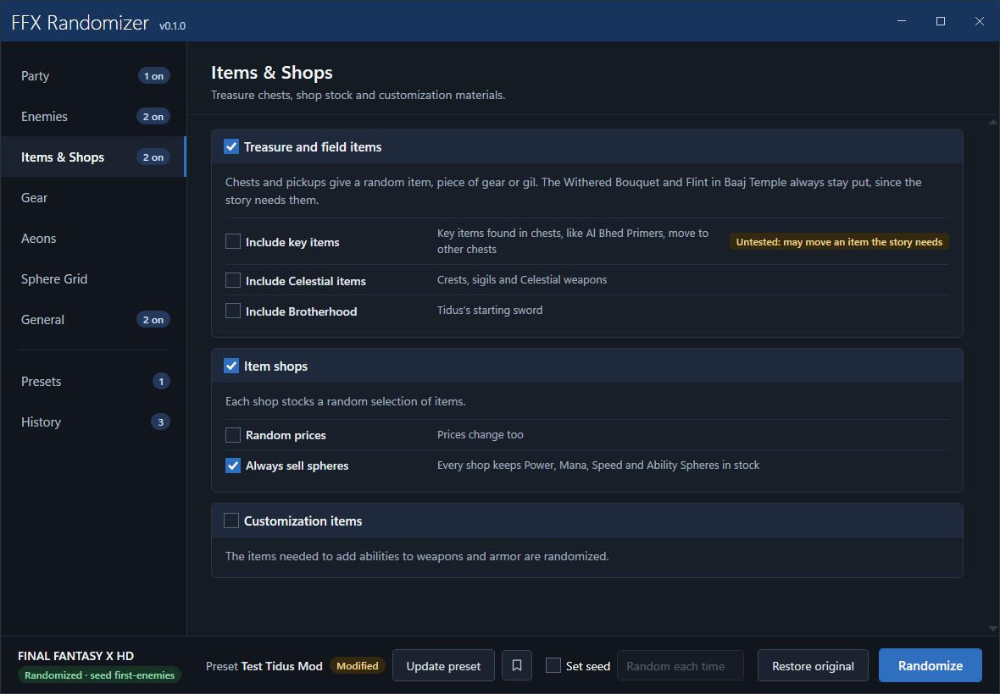

# FFX Randomizer

A randomizer for **FINAL FANTASY X** in the Steam release of *FINAL FANTASY X/X-2 HD Remaster*, with a one-click Windows app. It is a C# port of [FFXRando](https://github.com/nyterage/FFXRando) by nyterage.



## Getting started

1. Download `FFX-Randomizer-vX.Y.Z.exe` from [Releases](../../releases). It's a single self-contained file with nothing else to install.
2. Close the game, then run the exe. Windows SmartScreen may warn because the app isn't signed; click **More info → Run anyway**.
3. Pick your options and click **Randomize**.
4. Launch the game and start a **New Game**. Saves made before randomizing keep their old data.

The app finds your Steam copy automatically. If it can't, it asks you for the game folder (the one that contains `FFX.exe`).

| Pick your options | Randomize, then play |
|---|---|
|  |  |

The **Tidus starts with 9999 HP** option makes it easy to confirm the randomizer is working: it shows in the very first fight in Zanarkand.



### Undoing it

Click **Restore original** to put the game back exactly as Steam installed it. A Steam update or **Verify integrity of game files** also removes the randomization; just randomize again afterwards.

## What it can randomize

Everything FFXRando can randomize, plus Blitzball:

| Tab | Options |
|---|---|
| Party | Party stats (shuffle or randomize), starting Overdrive mode, deadly poison, and Tidus starts with 9999 HP (a quick check that randomizing works) |
| Enemies | Item drops, steals, bribes, gil and AP, equipment drops, elemental affinities, enemy stats, random encounters |
| Items & Shops | Treasure and field items (optionally key items, Celestial items, Brotherhood), item shops and prices, customization items |
| Gear | Gear abilities, weapon and armor shops and prices, weapon crit, attack and damage formula |
| Aeons | Base stats, stat growth, power-up items |
| Sphere Grid | Shuffle, controlled or fully random contents, empty or full grid, node strength, remove lock nodes |
| Blitzball | Player stats, shuffled between players or randomized (Tidus and Wakka only if you ask) |
| Story (experimental) | Skip cutscenes: hold the skip button during a scene (a prompt fills over about a second) or always skip. The skip button is yours to pick, or record it from a controller. Covers only the opening Zanarkand Ruins campfire scene so far |

**Keep things sane** (on by default) keeps the game playable:
- Random values stay within sensible limits.
- Weapons can't get a damage formula that deals no damage.
- Lock nodes stay where they are.
- The battle treasure chest and similar placeholder enemies aren't moved by random encounters.

Some things always hold, sane or not:
- The Withered Bouquet and Flint chests in Baaj Temple never move, because the story needs both to light the fire.
- With any Sphere Grid mode on, Rikku starts with Steal and Use, and the other abilities each character's tutorial needs are given at the start.

Sphere Grid changes only reach a new game. One Thunder Plains battle has been reported to crash with FFXRando's random encounters. If it happens, turn random encounters off or use No Encounters to get past it.

### Presets, seeds and History

- **Presets** save a set of options (not a seed), so every run from a preset is a new game. Built-in presets are read-only; duplicate one to make your own. Change options and click **Update preset** to save changes to the loaded preset.
- **Set seed** makes a specific game. The same seed, options and app version always produce the same game.
- **History** records every run with its seed and options. **Use settings** reloads the options with a new seed, and **Replay this seed** recreates the exact game.
- The **spoiler log** is JSON. It lists every change: each enemy's new drops, steals, bribe, elements and stats; every chest; every shop's stock; every piece of gear; character, aeon and Blitzball player stats; and which enemies replaced which.

| Presets | History |
|---|---|
|  |  |



## How it works

The 2026 Steam update to the HD Remaster isn't supported yet by the usual mod loaders (Fahrenheit, External File Loader). This app instead writes the randomized files straight into `data/FFX_Data.vbf`:

- New file data is appended to the end of the archive and the archive header is rewritten to point at it. The original data is never overwritten.
- Before the first change, the original header is backed up to `%LOCALAPPDATA%\FFX Randomizer\backup`. Restoring writes that header back and trims the archive to its original size, which returns it to the original byte for byte.
- Every run is checked before anything is written: valid item IDs, quantities in range, only the intended bytes changed, and the spoiler matching the files. After writing, every changed file is read back and compared.

Settings, presets, history, spoiler logs and the backup live in `%LOCALAPPDATA%\FFX Randomizer`.

## Building from source

Requires the .NET 10 SDK on Windows.

```
cd app
dotnet build FfxRandomizer.slnx
dotnet test FfxRandomizer.Tests          # tests that need the game run against your Steam install, read-only
dotnet publish FfxRandomizer.App -c Release -r win-x64 --self-contained -p:PublishSingleFile=true -p:IncludeNativeLibrariesForSelfExtract=true -p:EnableCompressionInSingleFile=true -o publish
```

Projects in `app/`:

- `FfxRandomizer.Core`: VBF reading and patching, game data, randomization features, presets and history.
- `FfxRandomizer.App`: the WPF app.
- `FfxRandomizer.Cli` (`ffxr`): developer commands, listed below.
- `FfxRandomizer.Tests`: unit tests, plus bulk-seed tests against the real game data.

### Developer commands

```
ffxr status                               # where the game is and whether it's randomized
ffxr apply [--seed X] <option>...         # randomize without the app, e.g. ffxr apply rewards drops estats=random
ffxr restore
ffxr crosscheck [--seeds N] [--sabotage] <option>...
ffxr save info <file>...                  # story progress, room, spawn, gil, play time, CRC check
ffxr save jump --from <file> --event <id> [--spawn N] [--moment N] (--slot N | --out <file>)
ffxr save list                            # test saves this tool wrote into the game's save folder
ffxr save delete --slot N
```

An option is a toggle id (`rewards`), a choice (`gridmode=shuffle`) or, for `crosscheck`, `-id` to switch a default off (`-sane`).

`crosscheck` randomizes in memory only and never touches the game. It decodes the output with [FFXDataParser](https://github.com/Karifean/FFXDataParser), an independent parser, and compares every area with the spoiler: enemies, battles, chests, shops, gear, party and aeon stats, the Sphere Grid and Blitzball players. `--sabotage` deliberately corrupts a few values to show the check catches them. It needs Java, a local build of FFXDataParser (`FFXDATAPARSER_DIR`, default `C:\Github\Personal\FFXDataParser`), and an extracted `ffx_ps2` folder (`FFXR_VANILLA_ROOT`). `tools/ffxdataparser.ps1` runs the parser on its own.

`save jump` copies a save and moves it to another field (an event id such as `ptkl1300`), so a scene can be tested without playing up to it. The game places the player by the save's saved room and spawn point; the load menu shows the area, and lists saves by the file's modified time. Saves sync through Steam Cloud (and OneDrive when Documents is redirected), so:
- `--slot` writes only to a free slot, never while the game is running, and stamps each new file a second newer than the newest save so the menu lists them in order.
- Each slot written is recorded with its hash in `%LOCALAPPDATA%\FFX Randomizer\test-saves.json`. `save delete` removes only those, and only if the file is unchanged; a player's own saves are never touched.
- Room ids come from a local FFXDataParser checkout (`FFXDATAPARSER_DIR`), since the game keeps that table in code; `--room N` overrides it. `--variant a|b|c|d` writes only some location fields, for diagnosing; the default writes all of them.

The original C++ FFXRando source is kept in `src/` as the reference for porting.

## Credits

- [FFXRando](https://github.com/nyterage/FFXRando) by nyterage: the randomization logic this app ports (MIT).
- [FFXDataParser](https://github.com/Karifean/FFXDataParser) by Karifean: game data research, and the independent check used in development.
- [VBFTool](https://github.com/topher-au/VBFTool) by topher-au: the VBF archive format.
- The [Fahrenheit](https://github.com/fahrenheit-crew/fahrenheit) project and the Cid's Salvage Ship community.
- [CSR2](https://github.com/fahrenheit-crew/fh-mods-csr), the Fahrenheit cutscene remover by The Fahrenheit contributors (MIT): which scenes to skip and where each one exits to.
